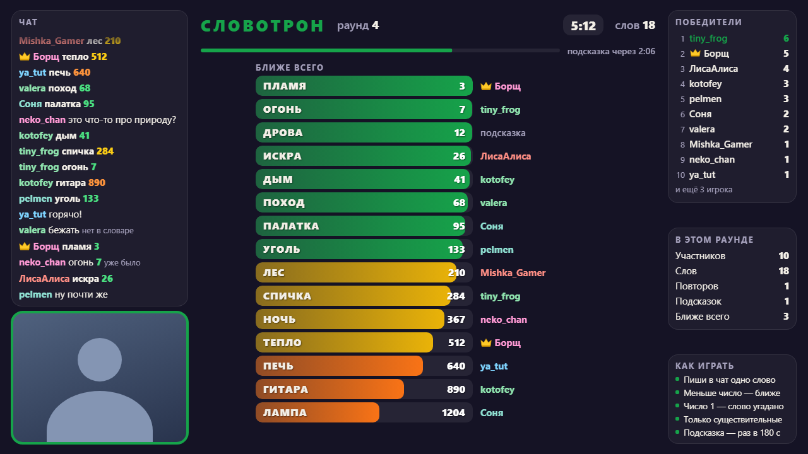
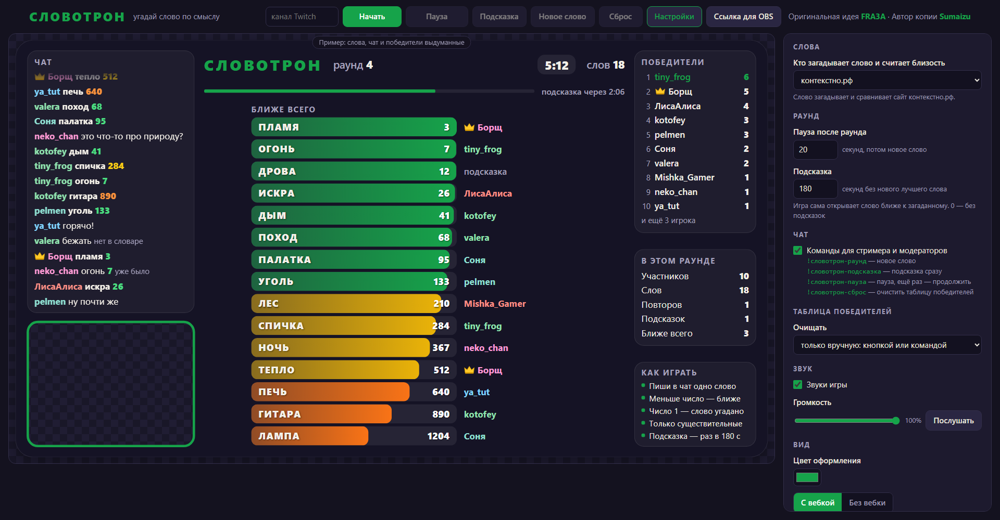
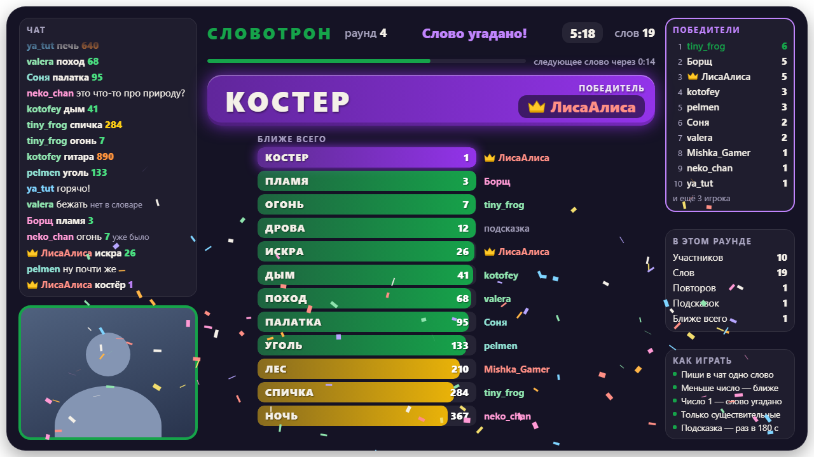

# Словотрон

Игра для чата Twitch — на русском языке. Загадано слово, зрители пишут в чат свои, а игра показывает число: насколько
каждое слово близко к загаданному по смыслу. Чем меньше число, тем ближе. Кто написал само слово — победил.



**[gamesonstream.ru/slovotron](https://gamesonstream.ru/slovotron/)** — играй прямо в браузере или вставь ссылку в OBS.

Ставить ничего не нужно: ни программ, ни регистрации, ни ключей Twitch.

Оригинальная идея — **[FRA3A](https://fra3a.ru/)**: это её игра
[«Словотрон 9000»](https://github.com/AnnaCodit/Slovotron). Автор этой копии —
**[Sumaizu](https://www.twitch.tv/sumaizu)**; она сделана с разрешения FRA3A: правила те же, вид и код — свои.

## Как запустить



**В браузере.** Открой [gamesonstream.ru/slovotron](https://gamesonstream.ru/slovotron/), впиши сверху свой канал
Twitch и нажми «Начать». Через 10 секунд пойдёт первый раунд, дальше раунды идут сами. Игра занимает всю страницу;
пока она не начата, на её месте пример с выдуманными словами, чатом и победителями.

Рядом с «Начать» — ещё четыре кнопки:

- **«Пауза»** замораживает игру: слова не засчитываются, отсчёты стоят. На экране — сведения о раунде и все
  победители; список можно листать. «Продолжить» возвращает раунд с того же места.
- **«Подсказка»** открывает подсказку сразу, не дожидаясь таймера.
- **«Новое слово»** заканчивает раунд, показывает загаданное слово и загадывает следующее.
- **«Сброс»** очищает таблицу победителей.

«Новое слово» и «Сброс» нужно нажать дважды — чтобы не задеть случайно.

**В OBS.** На той же странице нажми «Ссылка для OBS», скопируй ссылку и вставь её в источник «Браузер»: ширина
1920, высота 1080. Игра начнётся через 10 секунд после того, как источник появился на экране.

Кнопка «Настройки» открывает панель рядом с игрой. Сохранять ничего не нужно: правки сразу действуют на игру в
браузере, а ссылка для OBS обновляется сама.

Что полезно знать про OBS:

- **Сцены.** Скрыл источник или ушёл на другую сцену — игра встала на паузу. Вернулся — раунд продолжается с того
  же места. Если в свойствах источника отмечено «Отключать источник, когда он не виден», OBS выключает игру вместе
  с источником, и после возвращения начнётся новый раунд.
- **Вебка.** Окошко под вебку прозрачное: источник с камерой поставь в OBS под оверлей и подгони под рамку.
- **Звук** идёт из источника. Чтобы у игры была своя дорожка в микшере, включи в свойствах источника «Управление
  аудио через OBS».
- **Настройки зашиты в ссылку.** Поменял настройки — вставь в OBS новую ссылку.
- **Таблица победителей хранится в OBS.** Нужна игра в нескольких сценах — добавляй тот же источник («Добавить
  существующий»), а не новый: два разных источника с одной ссылкой — это две игры сразу.
- **Обновления.** Оверлей сам замечает, что игра обновилась, и перезагружается между раундами.

## Правила

- Игра загадала слово. Пиши в чат свои: **одно сообщение — одно слово**. Фразы и сообщения латиницей попытками не
  считаются.
- Рядом со словом появляется **число** — какое оно по счёту среди самых близких к загаданному по смыслу. Загадан
  «костёр» — у «огня» будет что-нибудь вроде 7, у «дров» — 12, у «телефона» — несколько тысяч.
- **Чем меньше число, тем ближе.** Число 1 — это само загаданное слово: кто его написал, тот победил.
- Годятся **существительные в начальной форме**: «река», «огонь». Слово, которого нет в словаре, помечается «нет в
  словаре». «Ё» и «е» — одна буква.
- Посередине — **ближе всего**: лучшие слова раунда, самое близкое сверху. Справа от слова — ник того, кто написал
  его первым. Все попытки с их числами видны в чате.
- **Полоса** у слова тем длиннее, чем слово ближе, а цвет показывает, насколько: зелёная — совсем рядом (до 150),
  жёлтая — до 550, оранжевая — до 1400, красная — далеко. Угаданное слово — фиолетовое.
- Слово, которое уже кто-то писал, второй раз не считается: помечено «уже было».
- После победы на экране плашка с загаданным словом и победителем, а через 20 секунд начинается следующий раунд.
  Победа записывается в **таблицу победителей**.
- У победителя последнего раунда перед ником стоит **золотая корона** — в чате, у слов и в таблице. Она остаётся
  у него, пока не победит кто-то другой.

## Подсказки

Подсказку игра даёт сама — по таймеру. Если за три минуты никто не написал слова ближе прежнего лучшего, игра
открывает слово, которое ближе к загаданному, чем лучшее из найденных. Сколько осталось до подсказки, видно на
полосе над словами. Новое лучшее слово запускает отсчёт заново.

Само загаданное слово подсказка не открывает никогда: когда лучшее число дошло до 2, таймер останавливается и
подсказок в раунде больше нет — последний шаг остаётся за чатом.

Срок задаётся в настройках, 0 — без подсказок. Стример и модераторы могут открыть подсказку сразу — кнопкой или
командой.

## Команды в чате

Для стримера и модераторов:

```
!словотрон-раунд        закончить раунд и загадать новое слово
!словотрон-подсказка    открыть подсказку сразу
!словотрон-пауза        поставить игру на паузу; ещё раз — продолжить
!словотрон-сброс        очистить таблицу победителей
```

Команды из оригинального «Словотрона» тоже работают: `!словотрон-рестарт`, `!словотрон-рес`, `!srestart` и `!sres`
загадывают новое слово, `!slovotron-hint` и `!slv-hint` открывают подсказку.

## Настройки

| Настройка | По умолчанию | Что делает |
| --- | --- | --- |
| Канал Twitch | — | Чей чат читать: логин или ссылка на канал |
| Кто загадывает слово | контекстно.рф | Сайт, который загадывает слово и считает близость: контекстно.рф или wordgun.ru |
| Сложность слов | любые слова | Только для wordgun.ru: насколько редкое слово может быть загадано |
| Пауза после раунда | 20 с | Сколько на экране висят загаданное слово и победитель |
| Подсказка | 180 с | Через сколько секунд без нового лучшего слова игра открывает слово ближе. 0 — без подсказок |
| Команды для стримера и модераторов | включены | `!словотрон-раунд`, `!словотрон-подсказка`, `!словотрон-пауза`, `!словотрон-сброс` |
| Очищать таблицу победителей | только вручную | Или сама: каждый день, неделю, месяц — в заданный час — либо по таймеру |
| Звуки и громкость | включены, 100% | Отсчёт, начало раунда, новое лучшее слово, подсказка, победа |
| Цвет оформления | зелёный | Цвет названия, отсчётов и всех акцентов оверлея |
| С вебкой / без вебки | с вебкой | Без вебки место окошка занимает чат |
| Скрыть чат | нет | Убирает левую панель целиком: чат и окошко под вебку |
| Убрать победителей и правила | нет | Убирает правую панель |
| Прозрачный фон | нет | Без тёмной подложки — если под игрой свой фон |

Значения по умолчанию — рекомендуемые: с ними страница открывается в первый раз, к ним же возвращает кнопка
«Рекомендуемые настройки».

Когда панели скрыты, поле игры остаётся на месте и того же размера — меньше становится только рамка вокруг.


## Что на экране



- **Чат** показывает все сообщения зрителей, у слов-попыток рядом стоит число того же цвета, что и полоса. Смайлики
  Twitch, 7TV, BetterTTV и FrankerFaceZ показываются картинками. Сообщения известных ботов в чат не попадают. Если
  модератор удалил сообщение или забанил зрителя, с экрана оно пропадает, а слово в столбике прячется за точками.
- **Грубые слова** игра проверяет, как и все остальные, но на экране от них остаётся первая буква и точки.
- **Победители** — в плашке справа: первая десятка и строка «и ещё столько-то». Все победители видны на паузе: там
  список листается. Таблица хранится в браузере, отдельно для каждого канала.
- **Правила** в правом нижнем углу подстраиваются под настройки.
- **Автор этой версии в чате.** Ник разработчика (Sumaizu на Twitch) вшит в игру: если он заглянет на стрим, его
  ник будет переливаться радугой, а сообщения в чате — стоять в такой же радужной рамке. Ещё у нескольких зрителей,
  которых отметил автор, свой цвет ника и своя рамка.

## Откуда слова

Своего словаря у игры нет. Слово загадывает и близость считает один из двух сайтов — какой, выбирается в
настройках:

- **[контекстно.рф](https://контекстно.рф)** — стоит по умолчанию. Умеет открыть загаданное слово, когда раунд
  закончили досрочно.
- **[wordgun.ru](https://wordgun.ru)** — можно выбрать сложность слов. Загаданное слово не открывает; из России
  сайт доступен не всегда.

Игра ходит на эти сайты прямо из браузера стримера: отправляет им слова из чата и получает числа. Если сайт не
отвечает, игра говорит об этом на экране и пробует снова. Числа у двух сайтов считаются по-разному, так что одно и
то же слово у них стоит на разном расстоянии.

## Для разработчиков

Игра — статические страницы на чистом JavaScript: без сборки и без сторонних библиотек.

```
site/index.html        главная страница: игра в браузере, настройки, ссылка для OBS
site/overlay.html      оверлей
site/js/page.js        главная страница
site/js/overlay.js     запуск оверлея: сам по себе в OBS или внутри главной страницы
site/js/engine.js      правила: раунды, попытки, подсказки, победа
site/js/backends.js    запросы к сайтам, которые загадывают слова
site/js/chat.js        чтение чата Twitch без токена
site/js/config.js      настройки и их упаковка в ссылку
site/js/view.js        отрисовка оверлея
site/js/confetti.js    конфетти
site/js/sound.js       звуки
site/js/emotes.js      смайлики 7TV, BetterTTV и FrankerFaceZ
site/js/demo.js        пример, который виден, пока игра не начата
site/data/             список слов, которые на экране прячутся
tests/js/              тесты
tools/                 локальный сервер, запуск тестов, снимки для README
```

Запустить у себя — `site.bat` или `python tools/serve.py`: откроется `http://127.0.0.1:8771/`. Нужен Python 3.9
или новее.

Тесты идут в скрытом браузере (Edge или Chrome), в сеть при этом не ходят:

```
pip install websocket-client
python tools/jstest.py
```

Картинки для этой страницы снимает `python tools/shots.py`.

Сайт выкладывается на GitHub Pages сам: когда в ветку `main` приходят изменения в папке `site/`, она публикуется
целиком (`.github/workflows/pages.yml`).

## Лицензия

Играть на своих стримах можно свободно — в том числе на стримах с донатами, подписками и рекламой.

Код открыт только для некоммерческого использования — лицензия
[PolyForm Noncommercial 1.0.0](LICENSE.md). Его можно читать, копировать и менять для себя. Продавать игру, её копии
и переделки, брать плату за доступ к ним и зарабатывать на них любым другим способом без разрешения автора нельзя.
За разрешением — к автору: [twitch.tv/sumaizu](https://twitch.tv/sumaizu).

Проект не связан с контекстно.рф, wordgun.ru и Twitch.
